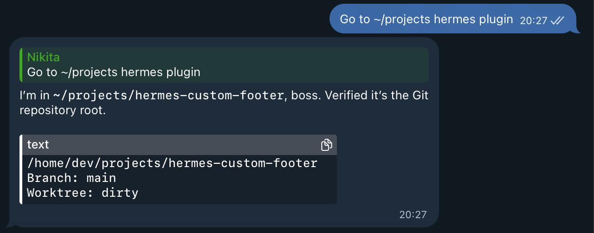

# Hermes Custom Footer

Append a trusted local command's stdout to the final assistant reply. The bundled `git_footer.py` prints the session directory and a compact Git status. No Hermes core files or messenger adapters need to be modified.

## Example: Telegram

With the bundled Git footer, you can tell at a glance:

- **When the agent is done:** the footer appears only on the final reply, not on progress updates.
- **Where the agent is working:** the footer shows the session's current working directory.
- **What Git sees:** the footer shows the current branch and whether the working tree is clean or has uncommitted changes.



## Install

Requirements: Linux and Hermes Agent **0.21.5 or later** (release tag `v2026.9.24`). The bundled Git footer also requires Python 3.9+ and Git. Windows and remote terminal backends aren't supported by this plugin.

Use Hermes's native installer. Replace `OWNER` with the repository owner's GitHub handle:

```sh
hermes plugins install OWNER/hermes-custom-footer --no-enable
```

For a trusted local clone with a commit, you can instead install from the repository root:

```sh
hermes plugins install "file://$(pwd -P)" --no-enable
```

Review the code and the command you plan to run before enabling the plugin. Do not force an install over an existing `custom-footer`; inspect the existing installation and back up your configuration before migrating it.

## Configure

Clone this repository and, from its root, run the optional helper to configure the bundled Git footer in the installed plugin:

```sh
./configure-git-footer.sh
hermes plugins enable custom-footer
```

The helper overwrites only `command` and `timeout_seconds` for `custom-footer`. It finds the plugin using the active profile's config path. For a named profile, use `./configure-git-footer.sh --profile NAME` and pass `--profile NAME` to the Hermes commands as well. Start a fresh Hermes process, or restart the running gateway when convenient, to load the plugin.

Alternatively, merge [config.example.yaml](config.example.yaml) into the file reported by `hermes config path`. Substitute actual absolute paths and retain other enabled plugins and settings. For a custom command, for example:

```yaml
plugins:
  entries:
    custom-footer:
      settings:
        command: [/usr/bin/git, status, --short, --branch]
        platforms: [telegram]
        timeout_seconds: 1.0
```

- **`command`** (required for output): a list of strings, starting with an absolute executable path followed by literal arguments. No shell expansion. A missing command is a no-op.
- **`platforms`** (optional): allowlist of platform names. Omit to allow any platform invoking the hook; `[]` matches none.
- **`timeout_seconds`** (optional): defaults to `1.0`; must be greater than zero and at most `5`.

## Runtime behavior

The command runs in the local terminal's last recorded working directory for the current session, so it follows `cd`. If the terminal has not recorded a directory, it uses the session's configured working directory or the normal Hermes fallback. The command gets empty stdin and a minimal environment (`PATH`, `LANG`, `CUSTOM_FOOTER_PLATFORM`). It does not receive the reply text, model or session ID. Empty stdout, nonzero exit, invalid UTF-8, timeout or more than 16 KiB of output leaves the reply unchanged. Progress, notifications and individual messenger chunks are not processed. The footer is part of the final reply and **is saved in session history**.

This is not a sandbox. The command runs with the Hermes user's permissions, and its stdout may be visible to chat recipients. Use trusted commands and scripts; do not print secrets. For the Git example, ahead/behind reflects the locally known upstream, not a live remote check.

## Hermes API compatibility

Install this plugin directly from Git; it is not listed in the official Hermes plugin catalog. It uses internal Hermes APIs to resolve the session's working directory and check its effective terminal backend. It skips the footer on non-local backends such as SSH and Docker rather than running the configured command against a similarly named path on the Hermes host.

The public `ctx.session_cwd()` API does not expose changes recorded by the terminal after `cd` or indicate whether the effective terminal backend is local. Both are needed to replace the internal APIs without changing the footer's behavior.

## Verify

```sh
hermes plugins doctor . --ci
# From the repository root, with a Hermes source checkout:
PYTHONPATH=/absolute/path/to/hermes-agent python3 -m unittest -v
```

Hermes Agent 0.21.5 is the first release that provides `agent.runtime_cwd.scoped_session_cwd`, which the plugin needs to pick the session's working directory.
